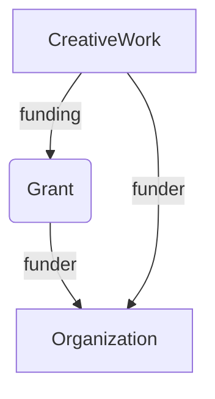

# Convert CSL-JSON to RDF

Convert CSL-JSON to RDF using terms from [schema.org](https://schema.org).


## Design considerations

### Funding

There are examples at [https://schema.org/Grant](https://schema.org/Grant).

If we have information on the grant and the funding agency:

```
{
  "@context": "https://schema.org",
  "@type": "Dataset",
  "@id": "https://doi.org/10.5061/dryad.m53r1",
  "funding": {
    "@type": "Grant",
    "identifier": "1452510",
    "funder": {
      "@type": "Organization",
      "name": "National Science Foundation",
      "identifier": "https://doi.org/10.13039/100000001"
     }
   }
}
```

We know the funder but don’t know the grant:

```
{
  "@context": "https://schema.org",
  "@type": "Dataset",
  "@id": "https://doi.org/10.5061/dryad.m53r1",
  "funder": {
     "@type": "Organization",
     "name": "National Science Foundation",
     "identifier": "https://doi.org/10.13039/100000001"
  }
}
```



For funding, consider using blank nodes for funders without DOIs. Yes, blank nodes can be problematic, but this would seem a good use case.

### Dates

If we want sensible query performance from a triplestore, then `schema:datePublished` should use `xsd` (`http://www.w3.org/2001/XMLSchema#`) date types, such as `xsd:date`, `xsd:gYear`, and `xsd:gYearMonth`. This enables us to readily query by years, etc. 

### Authorship

(discus how we do that, schema:creator versus schema:author, and whether we order authors or not).

### CSL-JSON and displaying references

Bibliographic references are best displayed using Citeproc to transform CSL-JSON, e.g. [Citation.js](https://citation.js.org). Rather than storing all the bibliographic details in RDF and bundling that into CSL-JSON, I store a CSL-JSON string as a [schema:encoding](https://schema.org/encoding). Hence, a client can take the JSON string and display the bibliographic object in whatever citation format they prefer (e.g., APA, BibTeX, RIS, etc.).

## Citations

### Cites (what works does this work cite?)

CrossRef typically includes a list of references cited by a work, these may or may not include a DOI.

### Cited by (what works cite this work?)

To find the number of citations of a work we can use [OpenCitations](https://opencitations.net). Their API requies a key, but can return a list of identifiers of works that cite a given DOI.

Note that OpenCitations records can include GBIF data citations, for example “Integrative revision of the Caryocolum schleichi species group - a striking example of a temporally changing species concept (Lepidoptera, Gelechiidae)” [doi:10.3897/alpento.4.50703](https://doi.org/10.3897/alpento.4.50703) has 55 citations in GBIF because the occurrence data for that paper has bene added to GBIF by Plazi, see [https://www.gbif.org/dataset/a9e0336c-85fe-4d7c-8998-fadb8b1e4a29](https://www.gbif.org/dataset/a9e0336c-85fe-4d7c-8998-fadb8b1e4a29). These citations are not paper -> paper citations, and hence will need to be filtered.

## Funders

CrossRef metadata can include DOIs for funders. These DOIs mauch records in the [Open Funder Registry (OFR)](https://www.crossref.org/services/funder-registry/), which is available as RDF from https://gitlab.com/crossref/open_funder_registry. If we have small number of records it will probably make sense to simply resolve the funder DOIs, which gives us a JSON record. Key facts could be extracted from this record and converted to schema.org terms.


