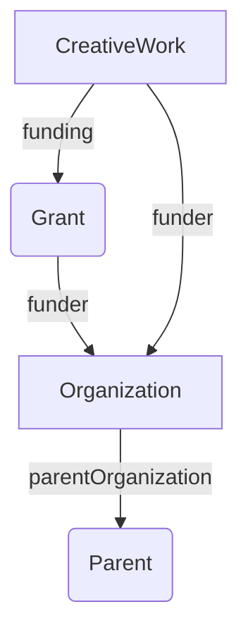

# Convert CSL-JSON to RDF

Convert CSL-JSON to RDF using terms from [schema.org](https://schema.org).

```
rpage@Rodericks-MacBook-Pro oxigraph % oxigraph load --location . --file ../../csl-to-rdf/g.nt
Error while loading file ../../csl-to-rdf/g.nt: Parser error between at line 74498 between columns 75 and column 150: Invalid IRI percent encoding '%jf'
rpage@Rodericks-MacBook-Pro oxigraph % oxigraph load --location . --file ../../csl-to-rdf/g.nt
Error while loading file ../../csl-to-rdf/g.nt: Parser error between at line 74502 between columns 75 and column 127: Invalid IRI percent encoding '%ja'
rpage@Rodericks-MacBook-Pro oxigraph % oxigraph load --location . --file ../../csl-to-rdf/g.nt
Error while loading file ../../csl-to-rdf/g.nt: Parser error between at line 88007 between columns 196 and column 198: Unexpected escape character '\D'
rpage@Rodericks-MacBook-Pro oxigraph % oxigraph load --location . --file ../../csl-to-rdf/g.nt
Error while loading file ../../csl-to-rdf/g.nt: Parser error between at line 403544 between columns 185 and column 187: Unexpected escape character '\ '
rpage@Rodericks-MacBook-Pro oxigraph % oxigraph load --location . --file ../../csl-to-rdf/g.nt
Error while loading file ../../csl-to-rdf/g.nt: Parser error between at line 1508923 between columns 72 and column 108: Invalid IRI code point '|'
rpage@Rodericks-MacBook-Pro oxigraph % oxigraph load --location . --file ../../csl-to-rdf/g.nt
Error while loading file ../../csl-to-rdf/g.nt: Parser error between at line 1571671 between columns 94 and column 96: Unexpected escape character '\i'
rpage@Rodericks-MacBook-Pro oxigraph % oxigraph load --location . --file ../../csl-to-rdf/g.nt
Error while loading file ../../csl-to-rdf/g.nt: Parser error between at line 1571743 between columns 162 and column 164: Unexpected escape character '\i'
rpage@Rodericks-MacBook-Pro oxigraph % oxigraph load --location . --file ../../csl-to-rdf/g.nt
Error while loading file ../../csl-to-rdf/g.nt: Parser error between at line 1571753 between columns 74 and column 76: Unexpected escape character '\v'
rpage@Rodericks-MacBook-Pro oxigraph % oxigraph load --location . --file ../../csl-to-rdf/g.nt
Error while loading file ../../csl-to-rdf/g.nt: Parser error between at line 1677174 between columns 126 and column 128: Unexpected escape character '\x'
rpage@Rodericks-MacBook-Pro oxigraph % oxigraph load --location . --file ../../csl-to-rdf/g.nt
Error while loading file ../../csl-to-rdf/g.nt: Parser error between at line 1917894 between columns 229 and column 231: Unexpected escape character '\T'
rpage@Rodericks-MacBook-Pro oxigraph % oxigraph load --location . --file ../../csl-to-rdf/g.nt
Error while loading file ../../csl-to-rdf/g.nt: Parser error between at line 2002438 between columns 100 and column 101: Invalid UTF-8: invalid utf-8 sequence of 2 bytes from index 27
rpage@Rodericks-MacBook-Pro oxigraph % oxigraph load --location . --file ../../csl-to-rdf/g.nt
Error while loading file ../../csl-to-rdf/g.nt: Parser error between at line 2002439 between columns 28 and column 29: Invalid UTF-8: invalid utf-8 sequence of 2 bytes from index 27
rpage@Rodericks-MacBook-Pro oxigraph % oxigraph load --location . --file ../../csl-to-rdf/g.nt
Error while loading file ../../csl-to-rdf/g.nt: Parser error between at line 2107676 between columns 133 and column 135: Unexpected escape character '\['
rpage@Rodericks-MacBook-Pro oxigraph % oxigraph load --location . --file ../../csl-to-rdf/g.nt
Error while loading file ../../csl-to-rdf/g.nt: Parser error between at line 2160579 between columns 108 and column 110: Unexpected escape character '\>'
rpage@Rodericks-MacBook-Pro oxigraph % oxigraph load --location . --file ../../csl-to-rdf/g.nt
Error while loading file ../../csl-to-rdf/g.nt: Parser error between at line 2206846 between columns 74 and column 121: Invalid IRI code point '"'
rpage@Rodericks-MacBook-Pro oxigraph % oxigraph load --location . --file ../../csl-to-rdf/g.nt
Error while loading file ../../csl-to-rdf/g.nt: Parser error between at line 2209877 between columns 108 and column 109: Invalid UTF-8: invalid utf-8 sequence of 2 bytes from index 34
rpage@Rodericks-MacBook-Pro oxigraph % oxigraph load --location . --file ../../csl-to-rdf/g.nt
Error while loading file ../../csl-to-rdf/g.nt: Parser error between at line 2259232 between columns 118 and column 119: Invalid UTF-8: invalid utf-8 sequence of 2 bytes from index 51
rpage@Rodericks-MacBook-Pro oxigraph % oxigraph load --location . --file ../../csl-to-rdf/g.nt
Error while loading file ../../csl-to-rdf/g.nt: Parser error between at line 2259233 between columns 52 and column 53: Invalid UTF-8: invalid utf-8 sequence of 2 bytes from index 51
rpage@Rodericks-MacBook-Pro oxigraph % oxigraph load --location . --file ../../csl-to-rdf/g.nt
Error while loading file ../../csl-to-rdf/g.nt: Parser error between at line 2259566 between columns 109 and column 110: Invalid UTF-8: invalid utf-8 sequence of 2 bytes from index 42
rpage@Rodericks-MacBook-Pro oxigraph % oxigraph load --location . --file ../../csl-to-rdf/g.nt
Error while loading file ../../csl-to-rdf/g.nt: Parser error between at line 2272511 between columns 1561 and column 1562: Unexpected escape character '\ï'
```


## Design considerations

### Funding

There are examples at https://schema.org/Grant

We have information on the grant and the funding agency

```
{
  "@context": "https://schema.org",
  "@type": "Dataset",
  "@id": "https://doi.org/10.5061/dryad.m53r1",
  "funding": {
    "@type": "Grant",
    "identifier": "1452510",
    "funder": {
      "@type": "Organization",
      "name": "National Science Foundation",
      "identifier": "https://doi.org/10.13039/100000001"
     }
   }
}
```

We know the funder but don’t know the grant.

```
{
  "@context": "https://schema.org",
  "@type": "Dataset",
  "@id": "https://doi.org/10.5061/dryad.m53r1",
  "funder": {
     "@type": "Organization",
     "name": "National Science Foundation",
     "identifier": "https://doi.org/10.13039/100000001"
  }
}
```



For funding consider using blank nodes for funders without DOIs. Yes blank nodes can be problematic, but this would seem a good use case.

### Dates

If we want sensible query performance then schema:datePublished should use xsd (`http://www.w3.org/2001/XMLSchema#`) date types, such as `xsd:date`, `xsd:gYear`, and `xsd:gYearMonth`. This enables us readily query by years, etc. 


