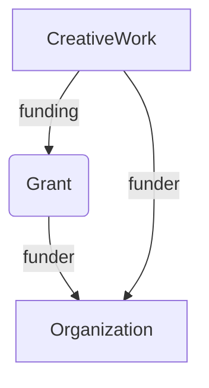

# Convert CSL-JSON to RDF

Convert CSL-JSON to RDF using terms from [schema.org](https://schema.org).


## Design considerations

### Funding

There are examples at [https://schema.org/Grant](https://schema.org/Grant).

If we have information on the grant and the funding agency:

```
{
  "@context": "https://schema.org",
  "@type": "Dataset",
  "@id": "https://doi.org/10.5061/dryad.m53r1",
  "funding": {
    "@type": "Grant",
    "identifier": "1452510",
    "funder": {
      "@type": "Organization",
      "name": "National Science Foundation",
      "identifier": "https://doi.org/10.13039/100000001"
     }
   }
}
```

We know the funder but don’t know the grant:

```
{
  "@context": "https://schema.org",
  "@type": "Dataset",
  "@id": "https://doi.org/10.5061/dryad.m53r1",
  "funder": {
     "@type": "Organization",
     "name": "National Science Foundation",
     "identifier": "https://doi.org/10.13039/100000001"
  }
}
```



For funding, consider using blank nodes for funders without DOIs. Yes, blank nodes can be problematic, but this would seem a good use case.

### Dates

If we want sensible query performance from a triplestore, then `schema:datePublished` should use `xsd` (`http://www.w3.org/2001/XMLSchema#`) date types, such as `xsd:date`, `xsd:gYear`, and `xsd:gYearMonth`. This enables us to readily query by years, etc. 

### CSL-JSON and displaying references

Bibliographic references are best displayed using Citeproc to transform CSL-JSON, e.g. [Citation.js](https://citation.js.org). Rather than storing all the bibliographic details in RDF and bundling that into CSL-JSON, I store a CSL-JSON string as a [schema:encoding](https://schema.org/encoding). Hence, a client can take the JSON string and display the bibliographic object in whatever citation format they prefer (e.g., APA, BibTeX, RIS, etc.).


